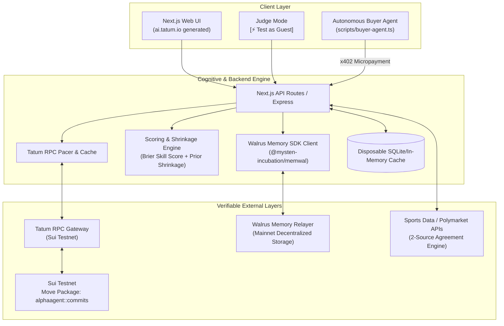
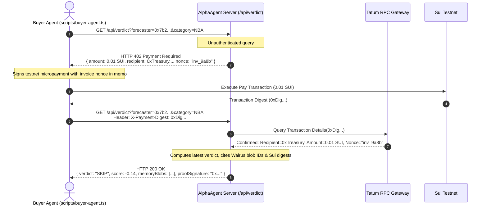
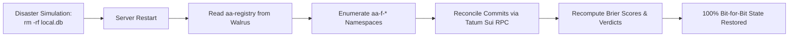

# AlphaAgent System Architecture

**Target Hackathon:** Tatum × Walrus Total Recall (Track 02: Smart Agents for Real Life)  
**Blockchain Environment:** Sui Testnet (Execution & Commits) + Walrus Mainnet (Memory Layer)  
**Gateway & Data Layer:** Tatum RPC & Data APIs  
**App Shell:** Next.js (Generated with `ai.tatum.io`) + TypeScript Node.js Backend  

---

## 1. High-Level Architectural Overview

AlphaAgent is designed around a three-tier verifiable architecture:
1. **The Immutable Ledger (Sui Testnet):** Acts as a cryptographic notary for time-stamping predictions, identity anchoring, and settling machine-to-machine x402 micropayments.
2. **The Decentralized Mind (Walrus Memory Mainnet):** Acts as the permanent, immutable system of record for resolved episodes, operational lessons, and reputation history.
3. **The Cognitive Engine (Node.js & Tatum Gateway):** Handles odds normalization, market baseline de-vigging, shrinkage math, semantic memory queries, and serves the UI shell.



---

## 2. On-Chain Smart Contract Layer (Sui Move)

### 2.1 Package: `alphaagent::commits`
A lean Move module deployed to Sui Testnet designed solely for tamper-proof time-anchoring with minimal gas overhead.

```move
module alphaagent::commits {
    use sui::clock::Clock;
    use sui::event;
    use sui::tx_context::{Self, TxContext};

    /// Event emitted whenever a forecaster cryptographically commits a pick
    public struct PickCommitted has copy, drop {
        forecaster: address,
        commit_hash: vector<u8>,
        committed_at_ms: u64,
    }

    /// Single entry point for committing a pick hash
    public entry fun commit(
        commit_hash: vector<u8>,
        clock: &Clock,
        ctx: &TxContext
    ) {
        event::emit(PickCommitted {
            forecaster: tx_context::sender(ctx),
            commit_hash,
            committed_at_ms: clock.timestamp_ms(),
        });
    }
}
```

### 2.2 Why On-Chain Events Over Shared Objects?
- Emitting events costs negligible gas (~0.001 SUI per commit).
- Avoids state-contention on shared objects during high-frequency pick submissions.
- Indexed natively by Tatum RPC for instantaneous filtering and historical completeness queries.

---

## 3. Tatum Gateway & RPC Integration Layer

Tatum serves as the high-availability bridge between the backend cognitive engine and Sui Testnet.

### 3.1 Rate Pacing and In-Memory LRU Caching
* **Free Tier Constraint:** ~3 requests per second.
* **Architecture Pattern:** A token-bucket rate limiter (`p-queue` or custom Leaky Bucket) ensures outbound Tatum RPC calls never breach rate limits.
* **Cache Architecture:**
  - Checkpoint and transaction digests are cached permanently once confirmed (immutable).
  - Completeness query responses are cached for 60 seconds.

```typescript
// services/tatumClient.ts
import { TatumSDK, Network, Sui } from '@tatumio/sui';

class TatumPacedClient {
  private queue: PQueue;
  private cache: LRUCache<string, any>;

  constructor() {
    this.queue = new PQueue({ concurrency: 1, interval: 350, intervalCap: 1 });
    this.cache = new LRUCache({ max: 1000, ttl: 1000 * 60 * 5 });
  }

  async getTransaction(digest: string) {
    if (this.cache.has(digest)) return this.cache.get(digest);
    return this.queue.add(async () => {
      const res = await tatumSui.rpc.getTransactionBlock({ digest, options: { showEvents: true } });
      this.cache.set(digest, res);
      return res;
    });
  }
}
```

---

## 4. Walrus Memory Layer (Decentralized Brain)

Walrus Memory provides the immutable memory layer, hosted on Walrus Mainnet via the official relayer.

### 4.1 Memory Schema Definitions
All records written to Walrus Memory are formatted as versioned, strict machine-readable canonical strings:

```
[RECORD_TYPE] | [VERSION] | [ATTRIBUTES...]
```

#### 1. EPISODE (Written at event resolution)
```text
EPISODE | v1 | forecaster 0x7b2f...9a1 | category NBA | event LAL vs GSW | pick LAL | forecast 0.65 | market 0.52 (source: OddsAPI, de-vigged, ts: 1730246400) | outcome win | commit_tx 5XyZ... | commit_ts 1730246400 | sources agree 2/2 | resolved 1730300000
```

#### 2. STATUS (Written for non-resolved commits)
```text
STATUS | v1 | forecaster 0x7b2f...9a1 | commit_tx 5XyZ... | state forfeited | reason unrevealed by kickoff
```

#### 3. LESSON (Synthesized dynamically after every 5 resolved picks)
```text
LESSON | v1 | forecaster 0x7b2f...9a1 | category NBA | band high_confidence (>=75%) | finding: 1 of 5 high_confidence won, BSS -0.32 | rule: SKIP high_confidence NBA picks until n>=8 and BSS>0
```

#### 4. VERDICT (Snapshot of reputation state changes)
```text
VERDICT | v1 | forecaster 0x7b2f...9a1 | state WATCH -> SKIP | category NBA | reason lesson rule applied (blob: walrus_blob_48b1...) | ts 1730300500
```

### 4.2 Namespace Hierarchy
* `aa-registry`: Global list of monitored forecasters.
* `aa-f-<address_prefix>`: Forecaster-specific partition holding episodes, statuses, and lessons.
* `aa-fixtures-<scenario_id>`: Synthetic edge-case benchmarks (clearly segregated from live cohorts).

---

## 5. Machine-to-Machine x402 Micropayment Flow

The x402 protocol turns AlphaAgent into an autonomous economic entity that sells its verification proofs to other agents.



---

## 6. The Database Wipe Recovery Engine

To prove decentralization, local databases (SQLite or Redis) operate strictly as ephemeral read-caches. 



1. CLI Command: `pnpm test:wipe-rebuild`.
2. Deletes local storage completely.
3. Cold-boots the agent:
   - Queries `aa-registry` in Walrus to discover all monitored forecaster addresses.
   - Streams all `EPISODE`, `STATUS`, and `LESSON` blobs across all namespaces.
   - Cross-checks with Tatum Sui RPC to ensure zero unrevealed commits were omitted.
   - Re-evaluates mathematical shrinkage formulas.
   - Asserts 100% parity against pre-wipe verdict snapshots.

---

## 7. Frontend Architecture (Next.js & Tatum AI Builder)

The UI is divided into 4 high-impact views:
1. **Landing & Judge Mode:** Prominent `[⚡ Test as Guest (1-Click)]` hero button. Ephemeral key generation, instant funded wallet, pre-filled upcoming game slip.
2. **Predictor Portal (`/pick`):** Connect Sui wallet, generate canonical JSON pick, execute on-chain commit, view live Tatum transaction read-back.
3. **Agent Dashboard (`/agent`):** Displays real-time verdicts (`FOLLOW`, `WATCH`, `SKIP`), active monitored forecasters, and learned lesson rules.
4. **Verifiable Audit Page (`/verify` & `/proof`):**
   - Live reconciliation table: Sui Commits vs. Walrus Episodes vs. Forfeits.
   - Mathematical proof breakdown: Brier user vs Brier market, prior shrinkage formula ($k=10$).
   - Direct clickable links to SuiVision Testnet explorer and Walrus Mainnet explorer.
   - Interactive Luck Simulation visualizer (Luck Lab).

