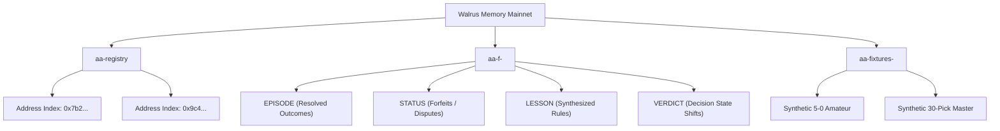
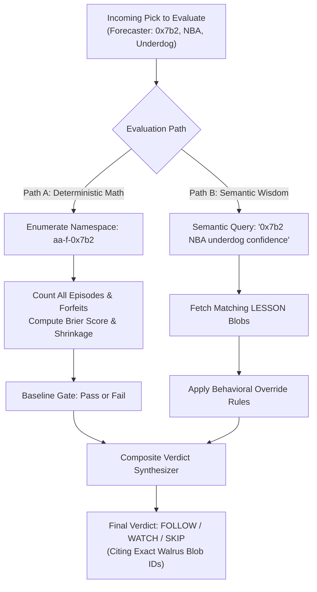

# AlphaAgent: Walrus Memory Architecture & Specification

**Subsystem:** Decentralized Cognitive Memory (System of Record)  
**Target Award:** Best Walrus Memory ($500)  
**Network Environment:** Walrus Mainnet (Relayer / Delegated Agent Keys)  
**SDK Package:** `@mysten-incubation/memwal`  

---

## 1. Memory Philosophy: Visible Learning vs. Dumb Storage

Most hackathon entries use decentralized storage as an inert JSON dump—equivalent to an expensive key-value database. 

AlphaAgent treats Walrus Memory as an **active, evolving cognitive brain**:
1. **Verdicts change dynamically as memories accumulate:** The agent does not simply store picks; it synthesizes deterministic **LESSONS** from clusters of resolved outcomes. If a forecaster performs poorly on high-confidence underdogs, a newly forged lesson instructs the agent to issue `SKIP` on future underdogs, citing the specific Walrus memory blob.
2. **Total Disaster Recovery (Zero-Loss Brain):** If the backend server burns to the ground and `local.db` is completely erased, the agent boots from cold storage, scans Walrus Mainnet, and reconstructs every trust score, lesson rule, and verdict identically.

---

## 2. Namespace Hierarchy

Walrus Memory uses flat namespace strings. AlphaAgent organizes its cognitive space into three strict partitions:



| Namespace | Format / Pattern | Purpose |
| :--- | :--- | :--- |
| **Global Registry** | `aa-registry` | Stores directory records of all forecasters monitored by AlphaAgent. |
| **Forecaster Partition** | `aa-f-<address_short>` (e.g. `aa-f-0x7b2f9a`) | Stores the granular memory stream for each individual forecaster. |
| **Synthetic Benchmarks** | `aa-fixtures-<tag>` (e.g. `aa-fixtures-5-0-amateur`) | Segregated synthetic fixtures for reproducible scoring demonstrations without polluting live data. |

---

## 3. Canonical Memory Record Schemas (v1)

To ensure version tolerance, zero ambiguous parses, and seamless regex parsing, every entry stored in Walrus Memory adheres to canonical pipe-delimited schemas.

### 3.1 EPISODE Schema
Written immediately upon two-source resolution of an event.

```text
EPISODE | v1 | forecaster <address> | category <cat> | event <event_id> | pick <side> | forecast <float> | market <float> (<source>, de-vigged, ts <unix>) | outcome <win|loss> | commit_tx <tx_digest> | commit_ts <unix> | sources agree <count>/<total> | resolved <unix>
```

*Example:*
```text
EPISODE | v1 | forecaster 0x7b2f3491a98bc19d | category NBA | event LAL_vs_GSW_20261102 | pick LAL | forecast 0.650 | market 0.520 (OddsAPI, de-vigged, ts 1730246400) | outcome win | commit_tx 5XyZ8aLpQ9... | commit_ts 1730246400 | sources agree 2/2 | resolved 1730300000
```

### 3.2 STATUS Schema
Written whenever an on-chain commit fails to reach normal resolution (essential for the completeness audit).

```text
STATUS | v1 | forecaster <address> | commit_tx <tx_digest> | state <forfeited|disputed|voided> | reason <string> | ts <unix>
```

*Example:*
```text
STATUS | v1 | forecaster 0x7b2f3491a98bc19d | commit_tx 3KjM9... | state forfeited | reason unrevealed by kickoff | ts 1730248000
```

### 3.3 LESSON Schema
Synthesized deterministically every 5 resolved picks. Expressed in human-readable English with machine-parsable logic.

```text
LESSON | v1 | forecaster <address> | category <cat> | band <odds_band> | finding: <summary> | rule: <ACTION> <criteria> | trigger_n <int> | ts <unix>
```

*Example:*
```text
LESSON | v1 | forecaster 0x7b2f3491a98bc19d | category NBA | band underdog (<=40%) | finding: 0 of 5 underdogs won, raw BSS -0.42 | rule: SKIP underdog NBA picks until n>=8 and BSS>0 | trigger_n 10 | ts 1730302000
```

### 3.4 VERDICT Schema (The Evolution Timeline)
Written whenever a forecaster's composite status transitions (e.g. from `WATCH` to `SKIP` or `WATCH` to `FOLLOW`), capturing the exact learning event.

```text
VERDICT | v1 | forecaster <address> | state_transition <PREV> -> <NEXT> | category <cat> | score <bss_shrunk> | sample_n <int> | cited_lessons <blob_ids> | ts <unix>
```

---

## 4. Dual Retrieval Strategy: Enumeration vs. Semantic Recall

Walrus Memory provides both semantic similarity retrieval and namespace enumeration. AlphaAgent utilizes both strategically:



1. **Deterministic Enumeration (The Mathematical Anchor):**
   * Scoring cannot rely on probabilistic vector search. To calculate Brier Skill Scores ($BSS_{\text{shrunk}}$) and forfeit percentages, the engine enumerates **100% of records** in `aa-f-<address>`. Every single commit on Sui must reconcile.
2. **Semantic Similarity Recall (The Behavioral Context):**
   * When evaluating a new pick (e.g., *"0x7b2 picking an NBA underdog at 35%"*), the agent constructs a natural language query into Walrus Memory.
   * Semantic recall surfaces relevant `LESSON` blobs. If a lesson explicitly flags underdogs for this forecaster, the agent triggers an override gate (`SKIP`) and directly embeds the Walrus blob citation in the output.

---

## 5. The Database Wipe Recovery Algorithm (`pnpm test:wipe-rebuild`)

This automated script serves as the undisputed proof for hackathon judges that Walrus Memory is the real database of record:

```typescript
// scripts/wipe-and-rebuild.ts
import { unlinkSync } from 'fs';
import { WalrusMemoryClient } from '../services/walrusClient';
import { ScoringEngine } from '../services/scoringEngine';

async function runDisasterRecovery() {
  console.log("💥 [DISASTER] Simulating complete server failure: erasing local cache...");
  unlinkSync('./data/cache.db');

  console.log("🔍 [RECOVERY] Querying Walrus Mainnet global registry 'aa-registry'...");
  const registry = await WalrusMemoryClient.listNamespace('aa-registry');
  const forecasters = registry.map(r => r.address);

  console.log(`📡 Discovered ${forecasters.length} forecasters on Walrus. Restoring state...`);

  for (const addr of forecasters) {
    const namespace = `aa-f-${addr.slice(0, 8)}`;
    const records = await WalrusMemoryClient.listNamespace(namespace);
    
    // Parse episodes, statuses, lessons
    const episodes = records.filter(r => r.startsWith('EPISODE'));
    const statuses = records.filter(r => r.startsWith('STATUS'));
    const lessons = records.filter(r => r.startsWith('LESSON'));

    // Recompute exact statistical profile
    const profile = ScoringEngine.computeProfile(episodes, statuses);
    const verdict = ScoringEngine.evaluateVerdict(profile, lessons);

    console.log(`✅ Restored ${addr}: Verdict=${verdict.state}, BSS=${profile.bssShrunk.toFixed(4)}`);
  }

  console.log("🎉 [SUCCESS] 100% Bit-for-bit parity restored entirely from Walrus Memory!");
}
```

---

## 6. Mainnet Write Budget & Hackathon Compliance

1. **Threshold Requirement:** The hackathon requires $\ge 10$ verified memory writes on Mainnet.
2. **Execution Strategy:**
   * **Seed Cohort:** 5 real forecaster identities initialized in `aa-registry`.
   * **Active Resolution Stream:** 3 real picks per day resolved across the cohort ($5 \times 3 \times 4 \text{ days} = 60 \text{ episode writes}$).
   * **Lesson Generation:** Dynamic lessons every 5 picks ($\approx 12 \text{ lesson writes}$).
   * **Status Logs:** Forfeits and disputes ($\approx 8 \text{ status writes}$).
   * **Total writes:** $> 80$ Mainnet memories stored, comfortably surpassing the 10-memory requirement by 8x.
3. **Throttling Protection:** Walrus memory writes are executed via a queue with 2000ms inter-write pacing to prevent rate-limit rejections.

