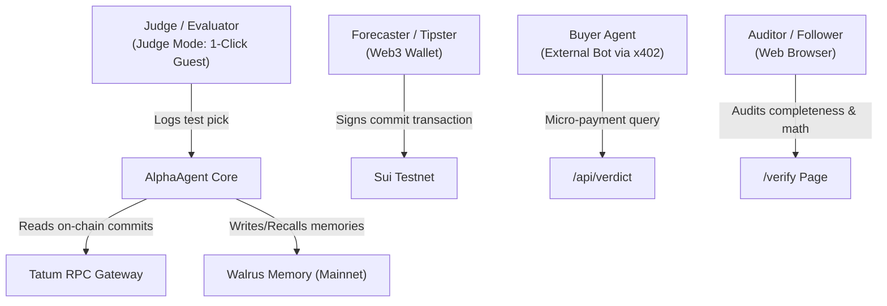

# Product Requirements Document (PRD): AlphaAgent

**Project:** AlphaAgent (Due-Diligence & Risk Auditing Agent for Autonomous Systems)  
**Hackathon:** Tatum × Walrus Total Recall (Track 02: Smart Agents for Real Life)  
**Target Submission:** November 10, 2026, 17:00 UTC (18:00 Lagos)  
**Status:** In Progress / Target Scope Freeze: November 3, 2026  
**Targeted Awards:** Track 02 1st Place ($500) + Best Walrus Memory ($500) + Best Use of Agent Payments ($500) = $1,500  

---

## 1. Executive Summary & Problem Statement

### 1.1 The Real-Life Problem
In decentralized social trading, sports prediction, and financial forecasting, followers suffer from rampant "tipster fraud":
1. **Selective Deletion:** Bad actors quietly delete losing picks and only leave winning tickets visible.
2. **Backdating & Faked Receipts:** Screenshots and predictions are forged or posted retroactively after game lines have already moved.
3. **Selling Lucky Streaks as Skill:** A novice forecaster flips a coin 5 times, wins all 5, claims a "100% win rate," and charges followers high subscription fees or misallocates capital before inevitably mean-reverting.

### 1.2 The AlphaAgent Solution
AlphaAgent is an autonomous due-diligence and risk auditing agent. It intercepts predictions before any capital or follow-action is committed, enforcing three uncompromising gates:
1. **On-Chain Pre-Kickoff Commitment:** Picks are cryptographically committed to Sui Testnet *before* kickoff.
2. **Reconciled Completeness:** Commits that are abandoned or unrevealed count as forfeits against the forecaster.
3. **Statistical Edge vs. Market:** Evaluates probabilistic forecasts against de-vigged market closing odds using Brier Skill Scores shrunk toward zero skill, distinguishing true mathematical edge from dumb luck.
4. **Permanent Decentralized Memory:** Stores all resolved episodes, operational lessons, and reputation evolutions in Walrus Memory on Mainnet. If local databases are wiped clean, AlphaAgent reconstructs its exact reputation engine directly from Walrus.
5. **Machine-to-Machine Commerce (x402):** External betting bots and risk allocators can query AlphaAgent programmatically via HTTP 402, paying micro-SUI on-chain to unlock verified credibility bundles.

---

## 2. Product Objectives & Success Metrics

| Objective | Target | Measurement |
| :--- | :--- | :--- |
| **Zero-Friction Evaluation** | < 30 seconds | Hackathon judges can test the full pick-and-audit loop via **Judge Mode** without installing a wallet. |
| **Statistical Rigor** | 0% false positives on 5-0 streaks | The engine returns `WATCH` or `SKIP` to 5-0 records with insufficient sample size. |
| **Decentralized Permanence** | 100% state recovery | After executing `rm -rf local.db`, the agent restores 100% of forecaster metrics from Walrus Memory. |
| **M2M Economy** | Full x402 settlement loop | Autonomous buyer script executes testnet SUI payment and unlocks cryptographically signed verdict. |
| **Mainnet Compliance** | $\ge 10$ Mainnet memories | Exceeds the hackathon minimum threshold for Mainnet Walrus Memory writes. |

---

## 3. User Personas & Roles



### Persona A: Hackathon Judge (The Evaluator)
- **Pain Point:** Has 120 seconds, refuses to install browser extensions, lacks testnet SUI.
- **Requirement:** One-click "Judge Mode" that provisions a funded ephemeral keypair and executes an end-to-end commit and agent inquiry instantly.

### Persona B: External Autonomous Bot (Buyer Agent)
- **Pain Point:** Needs verified predictive alpha before allocating funds, but cannot trust off-chain tipster APIs.
- **Requirement:** Machine-readable endpoint (`/api/verdict`), HTTP 402 payment challenge, testnet Sui payment settlement, and signed credibility receipt.

### Persona C: Retail Follower / Allocator
- **Pain Point:** Tired of losing money to Twitter/Telegram tipsters who delete losing tickets.
- **Requirement:** Unbiased 3-state verdict (`FOLLOW`, `WATCH`, `SKIP`), with transparent evidence outlining exactly what criteria are missing or passed.

### Persona D: Auditor / Researcher
- **Pain Point:** Needs mathematical proof that the agent is not playing favorites.
- **Requirement:** A `/verify` and `/proof` page showing raw Sui transaction digests, Walrus blob IDs, Brier Skill Score equations, and luck simulation curves.

---

## 4. Functional Specifications

### 4.1 Judge Mode (Zero-Friction Guest Access)
- **Trigger:** Single click on `[⚡ Test as Guest (1-Click)]`.
- **System Action:**
  1. Backend generates an ephemeral Ed25519 keypair in memory.
  2. Server transfers 0.05 testnet SUI from master faucet pool to guest address.
  3. UI logs guest in immediately, pre-populating a real upcoming match (e.g., NBA / NFL moneyline).
  4. Guest clicks "Commit Pick": backend signs and broadcasts Move transaction via Tatum.
  5. UI displays verified on-chain timestamp, commit hash, and captured market baseline.

### 4.2 The Commit-Reveal Protocol
- **Canonical Schema:**
  ```json
  {
    "eventId": "nba_20261102_lal_gsw",
    "category": "NBA",
    "side": "LAL",
    "probability": 0.65,
    "salt": "0x9f4a1c7e2b8d4f0a3e..."
  }
  ```
- **Commit Phase:**
  - Forecaster computes `commit_hash = SHA256(canonical_json)`.
  - Forecaster signs Sui Move transaction: `alphaagent::commits::commit(commit_hash, &Clock)`.
- **Reveal Phase:**
  - Full JSON payload and salt submitted to `/api/reveal`.
  - Backend verifies:
    1. Transaction sender matches author wallet.
    2. Event start time > `committed_at_ms`.
    3. Reveal timestamp $\le$ `committed_at_ms + 120 seconds` (to prevent stale-line exploitation).
  - Backend fetches live bookmaker decimal odds via Tatum / Odds API, computes de-vigged market probability baseline $m$, and logs the pick as `PENDING`.

### 4.3 Two-Source Event Resolution Engine
- Picks cannot be resolved with manual developer toggles.
- Resolution requires agreement between two independent public data providers:
  - Source 1: Odds API / bookmaker final box score.
  - Source 2: Public league data / Polymarket oracle resolution.
- Discrepancy Action: If sources disagree or game is postponed, mark as `DISPUTED` or `VOIDED`. Do not score.

### 4.4 Completeness Verification (Combating Cherry-Picking)
- Backend queries Tatum for all historical `PickCommitted` events for the address.
- Total Commits = $\text{Resolved} + \text{Pending} + \text{Voided} + \text{Disputed} + \text{Forfeited}$.
- **Forfeit Rule:** Any commit where kickoff passes without a valid reveal is permanently marked `FORFEITED`.
- **Forfeit Threshold:** If $\frac{\text{Forfeited Commits}}{\text{Total Commits}} > 10\%$, verdict is hard-locked to `SKIP`.

### 4.5 Statistical Decision & Shrinkage Engine
- **Formulas:**
  $$\text{BS}_{\text{user}} = (f - o)^2, \quad \text{BS}_{\text{mkt}} = (m - o)^2$$
  $$\text{BSS} = 1 - \frac{\sum \text{BS}_{\text{user}}}{\sum \text{BS}_{\text{mkt}}}$$
  $$\text{BSS}_{\text{shrunk}} = \text{BSS} \times \frac{n}{n + k} \quad (k = 10)$$
- **Verdict Rules:**
  - **`FOLLOW`**: Requires $n \ge 15$, $\sum \text{BS}_{\text{mkt}} \ge 1.0$, $\text{BSS}_{\text{shrunk}} \ge 0.02$, Bootstrap 80% lower bound $> 0$, Forfeit Rate $\le 10\%$, and category sample $n_{\text{cat}} \ge 8$ with positive shrunk score.
  - **`WATCH`**: Sample size insufficient (e.g. 5-0 record, low market variance). Explicitly outputs: *"Needs 10 more resolved games and verified CLV."*
  - **`SKIP`**: Negative skill score ($\text{BSS}_{\text{shrunk}} < 0$), high forfeit rate ($> 10\%$), or catastrophic category drawdown.

### 4.6 Walrus Memory Integration (Mainnet)
- All historical episodes, forecaster registry entries, and learned operational lessons are stored in Walrus Memory.
- **Namespaces:**
  - `aa-registry`: Registered forecaster directory.
  - `aa-f-<address>`: Forecaster episodes, statuses, and learned lessons.
  - `aa-fixtures-<tag>`: Synthetic benchmark scenarios (clearly tagged).
- **The Database Wipe Test (`rm -rf local.db`):**
  - An automated restoration suite reads Walrus Memory via the `@mysten-incubation/memwal` SDK, re-validates all blob hashes against Sui on-chain commit logs, and recalculates all verdicts with 100% bit-for-bit parity.

### 4.7 Agent Payments (x402 Protocol)
- **Endpoint:** `GET /api/verdict?forecaster=0x...&category=NBA`
- **Response (Unpaid):** `HTTP 402 Payment Required`
  ```json
  {
    "status": 402,
    "message": "Payment Required for Due Diligence Audit",
    "recipient": "0xAlphaAgentSuiTreasuryAddress...",
    "amount": "10000000",
    "token": "SUI",
    "nonce": "invoice_7f8a9b2c..."
  }
  ```
- **Payment & Settlement:**
  - Buyer agent submits payment on Sui testnet with the nonce embedded in memo/transaction.
  - Buyer re-calls endpoint with header: `X-Payment-Digest: <sui_tx_digest>`.
  - Server verifies on-chain payment via Tatum Sui RPC.
  - Server returns HTTP 200 with the full verified audit report, Walrus blob citations, and signature.

---

## 5. Non-Functional Requirements

1. **Latency & Throughput:**
   - Tatum RPC free tier rate limit: ~3 requests/second. All on-chain queries must implement an aggressive local memory LRU cache and rate-pacer.
2. **Reliability:**
   - Walrus write retries with exponential backoff to handle network congestion.
3. **Security:**
   - Server-side storage only for Tatum API keys and Walrus delegate keys.
   - Zero private keys exposed to browser clients except ephemeral testnet keys in Judge Mode.
4. **Transparency:**
   - Synthetic fixture profiles must clearly carry `[SYNTHETIC TEST FIXTURE]` banners to ensure judges know real cohort data from synthetic edge-case demonstrations.

