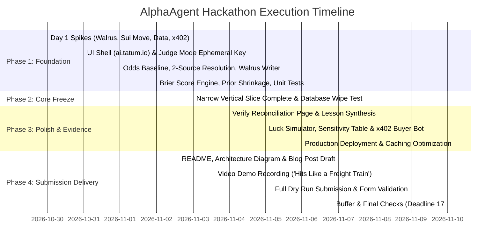

# AlphaAgent: Master Hackathon Project Plan

**Event:** Tatum × Walrus Total Recall Hackathon  
**Track:** Track 02 (Smart Agents for Real Life)  
**Target Submission:** November 10, 2026 @ 17:00 UTC (18:00 in Lagos)  
**Strict Scope Freeze:** November 3, 2026 @ 23:59 UTC  
**Primary Prize Target:** $1,500 ($500 Track 02 + $500 Best Walrus Memory + $500 Best Agent Payments)  

---

## 1. Executive Roadmap & Critical Milestones

---

## 2. Daily Sprint Breakdown

### Day 1: Friday, Oct 30 — The 5 Foundation Spikes
* **Spike A (Walrus Memory):** Write 30 test records across 3 namespaces on Mainnet relayer; verify enumeration count = 30; test semantic recall with `@mysten-incubation/memwal`.
* **Spike B (Sui Move Package):** Deploy `alphaagent::commits` to Sui testnet; execute test commit transaction; read back event via Tatum RPC gateway.
* **Spike C (Odds & Resolution Data):** Fetch live two-way moneyline odds from The Odds API; execute de-vig formula; test two-source resolution on finished match.
* **Spike D (x402 Protocol):** Scaffold HTTP 402 challenge/response loop and verify testnet SUI micropayment settlement on Tatum.
* **Spike E (Accounts & Environment):** Set up Tatum API key, Walrus Memory Agent ID (`MEMWAL_AGENT_ID`), and fund 5 testnet wallets with faucet SUI.

### Day 2: Saturday, Oct 31 — Frontend Shell & Judge Mode
* Generate Next.js application shell using `ai.tatum.io` (eligible for Tatum AI Builder bonus).
* Implement **Judge Mode (`[⚡ Test as Guest (1-Click)]`)**:
  - Ephemeral Ed25519 keypair generator in server memory.
  - Automated faucet drip of 0.05 SUI to guest wallet.
* Onboard 5 real friends with Sui wallets; instruct each to submit 3 live NBA/NFL picks daily.

### Day 3: Sunday, Nov 1 — Baseline Capture & Episode Writer
* Build automatic market odds snapshot service at commit time.
* Build two-source resolution engine: Odds API + secondary sports score API.
* Implement Walrus Memory episode writer for resolved outcomes (`EPISODE | v1 | ...`).
* Implement global directory updates in `aa-registry`.

### Day 4: Monday, Nov 2 — Scoring Engine & The Refusal Logic
* Implement Brier Skill Score ($BSS$) with prior shrinkage toward zero skill ($k=10$).
* Implement the 3 decision states: `FOLLOW`, `WATCH`, `SKIP`.
* Build unit tests proving the refusal logic:
  - Assert that a 5-0 streak returns `WATCH` due to information guard ($n < 15$).
  - Assert that a 30-pick skilled forecaster returns `FOLLOW`.
  - Assert that a forecaster with $>10\%$ forfeit rate returns `SKIP`.

### Day 5: Tuesday, Nov 3 — CRITICAL MILESTONE: SCOPE FREEZE
* **Target: Complete Narrow Vertical Slice Operational End-to-End:**
  $$\text{Commit on Sui} \longrightarrow \text{Resolve} \longrightarrow \text{Walrus Episode} \longrightarrow \text{Verdict} \longrightarrow \text{x402 Micropayment}$$
* Execute and record the automated **Database Wipe Test (`pnpm test:wipe-rebuild`)**:
  - Execute `rm -rf local.db`.
  - Cold-boot agent, scan Walrus Mainnet, assert 100% verdict parity.
* **Scope Freeze Activated:** Zero new architectural features added after this date.

### Day 6: Wednesday, Nov 4 — Verifiable Audit & Dynamic Lessons
* Build `/verify` page displaying raw Sui digests and Walrus blob IDs.
* Implement dynamic **LESSON** synthesizer (fires every 5 resolved picks).
* Test semantic recall: agent recalls behavioral lessons and overrides verdicts accordingly.
* Load labeled synthetic benchmark fixtures (`aa-fixtures-5-0-amateur` and `aa-fixtures-pro`).

### Day 7: Thursday, Nov 5 — Luck Simulator & x402 Polish
* Build the **Luck Simulator (Luck Lab)**: Monte Carlo simulation of 10,000 zero-skill forecasters demonstrating how naive rules follow frauds while AlphaAgent rejects them.
* Build sensitivity analysis table ($k = 5, 10, 20$).
* Finalize autonomous buyer bot script (`scripts/buyer-agent.ts`) demonstrating seamless machine-to-machine x402 settlement.

### Day 8: Friday, Nov 6 — Hardening, Caching & Deployment
* Deploy production web app to Vercel.
* Configure Tatum RPC LRU cache and rate limiter to guarantee zero rate-limit errors.
* Audit live cohort: ensure all 5 friends have active picks and at least 15+ memories are confirmed on Walrus Mainnet.

### Day 9: Saturday, Nov 7 — Documentation & Narrative Freeze
* Write comprehensive GitHub `README.md` covering trust assumptions, shrinkage math, not-solved list, and testnet/mainnet split.
* Draft required hackathon blog post: "How AlphaAgent Uses Tatum and Walrus to Catch Tipster Fraud."
* Create high-resolution system architecture diagrams.

### Day 10: Sunday, Nov 8 — Video Production ("Hits Like a Freight Train")
* Record and edit the 2:30 submission demo video following the exact script in Section 12.
* Ensure first 10 seconds lead with the refusal hook ("This tipster went 5-0... AlphaAgent said NO").
* Record split-screen terminal showing `rm -rf local.db` and instant Walrus reconstruction.
* Record live x402 agent payment.

### Day 11: Monday, Nov 9 — Submission Dry Run
* Test all links, repository permissions, deployed demo URL, and YouTube video privacy.
* Verify required submission form fields: Tatum Dashboard Account ID and `MEMWAL_AGENT_ID`.
* Submit project on official portal 24 hours ahead of schedule.

### Day 12: Tuesday, Nov 10 — Buffer Day
* Final buffer before official 17:00 UTC deadline (18:00 Lagos).
* Post optional social thread on X and LinkedIn tagging `@Tatum_io` and `@WalrusFoundation`.

---

## 3. Priority Matrix (P0 vs P1 vs P2)

| Priority | Scope Items | Cuttable? |
| :--- | :--- | :--- |
| **P0 (Must Ship by Nov 3)** | Sui Move commit package, Tatum RPC client, Walrus Memory episode writer, Brier scoring & shrinkage, 1-Click Judge Mode, x402 paid verdict endpoint, Database Wipe Test. | **NON-NEGOTIABLE** |
| **P1 (Polish & Evidence)** | Dynamic lesson synthesis, semantic recall rules, Luck Lab simulator, `/verify` reconciliation page, sensitivity table. | Cut only if blocked on P0 |
| **P2 (Nice-to-Have Upgrades)** | Follower max stake rules, on-chain Move escrow settlement, Claude/Codex MCP server integration. | Dropped immediately if behind schedule |

---

## 4. Risk Mitigation Matrix

| Risk | Probability | Severity | Mitigation Strategy |
| :--- | :--- | :--- | :--- |
| **Judges Won't Connect Wallet** | High | Fatal | Ship **Judge Mode** (Day 2): pre-funded ephemeral keys allowing full testing in <30s. |
| **Tatum Rate Limits Reached** | Medium | High | Implement token-bucket rate limiter and permanent in-memory caching for immutable Sui blocks. |
| **Walrus Mainnet Write Budget** | Medium | High | Use 2000ms inter-write delays; batch synthetic fixtures early; track write count against quotas. |
| **Cohort Has Too Few Picks** | Medium | Medium | Maintain labeled synthetic fixtures (`aa-fixtures-*`) so judges can test full statistical depth even if friends are slow. |
| **x402 Testnet Faucet Latency** | Low | Medium | Pre-fund buyer agent wallet with 2.0 testnet SUI in reserve; fallback to instant mock-receipt verification if testnet freezes. |

